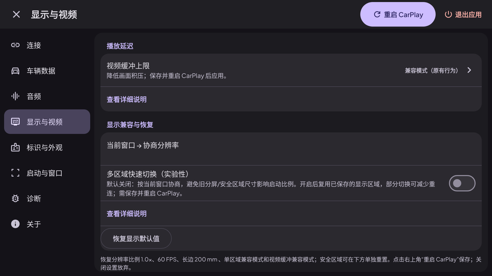
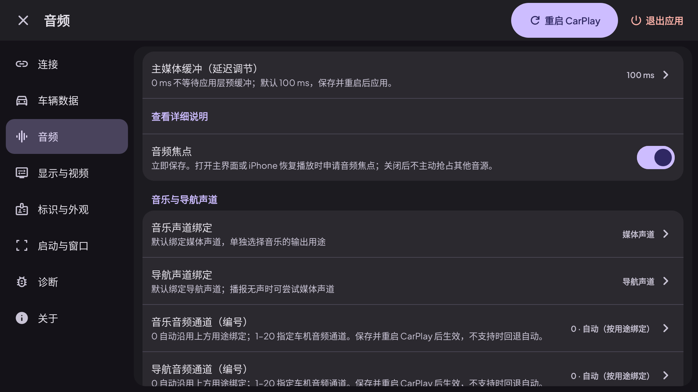

# 等待页、设置与音视频缓冲

本轮先更新源码、执行测试并提供截图，暂不生成 APK。版本基础仍为 1.4.2；打包身份和固定签名规则保持原样。

## 页面与配置核对

| 页面 | 主要内容 | 生效与保存 |
| --- | --- | --- |
| 连接等待页 | 中文当前状态、四阶段进度、连接检查；右上角设置与连接详情 | 查看详情只改变显示，不重连；重试仍由原有失败重试逻辑控制。 |
| 连接 | 传输方式、MFi 认证、信道策略；高级项包含高性能、启动恢复和 ADB 扫描抑制 | 重启 CarPlay 保存应用；折叠不会关闭选项。ADB 授权与功能开关分开。 |
| 音频 | 主媒体缓冲置顶、音频焦点、音乐/导航用途和编号绑定、导航增益、音质、麦克风 | 缓冲和声道等通过重启保存；音频焦点维持原先的立即保存行为，并明确标注。 |
| 显示与视频 | 视频缓冲置顶、显示兼容、比例/帧率/物理尺寸、HEVC、安全区域 | 重启保存，关闭放弃；恢复显示默认值也恢复视频缓冲兼容模式。 |
| 车辆数据 | 位置、只读 BYD ADB 数据、各字段开关及诊断 | 保留原有权限、字段和默认值；无旧车辆 JSON 导入。 |
| 标识与外观、启动与窗口 | 原有标识、外观、启动、窗口及手势 | 沿用原有保存与回退规则；不增加临时系统栏。 |
| 诊断与关于 | 媒体延迟、日志与采集选项、系统蓝牙、配置摘要；应用/Android 版本 | 诊断开关的预览与保存方式保持原样；关于只读。 |

宽屏选择项将值放在右侧；窄屏/大字体改为上下排列。长说明按需展开。重启/退出按钮固定在顶部；正文独立滚动。等待页使用窗口密度与独立字体规格，避免旧主屏的比例放大挤占空间。

## 视频缓冲

选项为兼容、0、20、50、100、150、200、250、300 ms。**默认兼容**保留原有 8 帧压缩输入队列与逐帧输出。

其他档位用 `ceil(毫秒 × 协商帧率 / 1000)` 限制输入队列，最少一帧；0 ms 只留一个排队名额。压缩参考帧仍按顺序送入解码，队满通过原有背压处理，不能任意删除 H.264/H.265 参考帧。

处理已解码输出时，0 ms 在本次已有多个就绪画面的情况下只显示最新一个；正数档位只跳过超时且已有后续输出的画面。最后一帧/静止画面始终显示，不等待下一包或定时器。它控制积压预算，不人为攒够指定时间，也不是端到端延迟保证或声画同步偏移。

## 音频 0 ms

主媒体缓冲增加 0，保留 20 和 50–1000 ms；**默认 100 ms**，不改动已有值。0 ms 请求系统最小 AudioTrack 容量，首个 PCM 采样帧写入后调用播放，不等待应用层预缓冲门槛。Android 12+ 额外尝试请求一帧设备启动门槛；不支持或固件拒绝时由设备决定。

Android、驱动、功放和扬声器仍有最低延迟，0 不是物理零延迟。此项只针对主媒体音乐（包括已识别的 102/default），不改变导航、通话、Siri、麦克风缓冲及独立导航音量。低缓冲更容易断续，可从 50 ms 向 20/0 ms 逐步尝试。

## Web 渲染删除范围

删除 Web 服务、证书、HTML、HTTP/WebSocket 依赖、远程触控与音视频转发、Web 配置持久化接口、构建开关、可选源码集和 CI 任务，以及只在 Web 仪表输出下启用的预览浮窗。保留本地主屏和共享协议中的媒体处理；旧 `web_display_*` 偏好不再读取，不能重定向播放。

## 截图和验证

截图通过 Robolectric Android 13 / API 33 的原生绘图生成。主要设置截图为 1920 × 1080、320 DPI，直接渲染应用实际的 `SettingsScreen`；不运行真实车机、ADB 或 CarPlay 传输。缓冲选项弹窗单独捕获其真实窗口。等待页另覆盖低密度 1080P 与 150% 字体窄窗口。

自动化检查涵盖保存/重载/放弃、旧 Web 偏好不能新增菜单、已删除类与依赖缺席、参考帧不因队列容量被丢弃、过期输出追赶、静止帧保留、音频 0 ms 首帧启动，以及移除 Web 转发后的本地导航增益。

2026-10-21 验证源码：`3b228560ebb64c98b69d7d0fc72c24344102cfe6`。[任务 39561641865](https://github.com/whoyang233/xcertplay/actions/runs/39561641865)通过 418 项单元测试，失败/错误/跳过均为 0；Lint 无错误（common 82、automotive 3 条警告）。仅验证模式的签名、APK 打包、APK 校验和 APK 上传均跳过。完整报告另有 26 张截图；以下选取实际页面和等待页。

| 页面 | 截图 |
| --- | --- |
| 连接等待页 | [1080P](screenshots/ui-refresh/00-waiting.png) / [150% 字体窄窗口](screenshots/ui-refresh/12-waiting-narrow-font150.png) |
| 连接 | [传输、认证与信道](screenshots/ui-refresh/01-connection.png) |
| 高级无线连接 | [高性能、恢复与 ADB](screenshots/ui-refresh/02-connection-advanced.png) |
| 车辆数据 | [位置与车辆开关](screenshots/ui-refresh/03-vehicle.png) |
| 音频绑定 | [音乐、导航、编号与音量](screenshots/ui-refresh/04-audio-routing.png) |
| 音频缓冲 | [音频设置](screenshots/ui-refresh/05-audio-buffer.png) / [含 0 ms 的选项](screenshots/ui-refresh/11-audio-presets.png) |
| 显示与视频 | [视频缓冲置顶](screenshots/ui-refresh/06-display.png) / [视频配置](screenshots/ui-refresh/07-video-buffer.png) / [含 0 ms 的选项](screenshots/ui-refresh/10-video-presets.png) |
| 启动与窗口 | [启动、窗口及手势](screenshots/ui-refresh/08-window.png) |
| 诊断 | [日志与媒体监测](screenshots/ui-refresh/09-diagnostics.png) |

展开查看视频设置与 0 ms 选项

展开查看音频设置与 0 ms 选项

